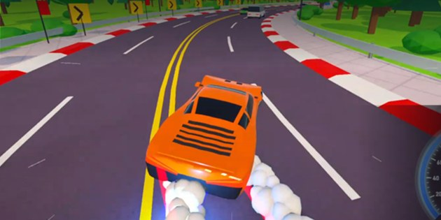

<div align="center">

# Nitro Drift

[English](README.md) | **Türkçe**

Unity ile yapılmış, tek oyunculu, sonsuz bir arcade yarış oyunu.<br>
Oyundaki her şey (arabalar, yol, manzara, efektler, motor sesleri ve müzik) kodla üretiliyor. Hazır model, doku ya da ses dosyası kullanılmadı.

### [▶ itch.io'da Oyna](https://cannes035.itch.io/nitro-drift)



</div>

## Hakkında

Süre bitmeden olabildiğince uzağa git: drift at, nitro yak, trafiğin arasından makas at ve rekorunu kır. Kontrol noktası kapıları süre ekler, drift zincirleri komboyu büyütür, hayatta kaldıkça trafik de kalabalıklaşır.

## Kontroller

| Tuş | İşlev |
| --- | --- |
| `W` / `S` (ya da oklar) | Gaz / fren |
| `A` / `D` (ya da oklar) | Direksiyon |
| `Space` | Drift |
| `Shift` | Nitro |
| `Esc` / `P` | Duraklat |
| `Enter` / `Space` (menüde) | Başla |
| `G` (menüde) | Garaj |
| `Tab` (menüde) | Ayarlar |
| `I` (menüde) | İstatistikler |

## Özellikler

- **Süreye karşı yarış**: süre geri sayar, kontrol noktası kapıları süre ekler
- **Puan**: mesafe + drift zinciri × kombo + kapı bonusu, yakın geçiş ve uçuş bonusları
- **2 harita**: virajlı yol ve karşı trafikli otoyol (ters şeritte kaldıkça artan puan çarpanı, tüneller ve köprüler)
- **4 manzara**: orman, çöl, karlı dağ ve sahil
- **Zaman ve hava**: gündüz, gün batımı ve gece; açık hava ya da ıslak yol yansımaları ve şimşekli yağmur
- **3 araba**: süper spor, muscle (V8 sesi) ve traktör (dizel sesi); her birinin kendi özellikleri var
- **Garaj**: kazandığın kredilerle araba satın al, motor / nitro / yol tutuş yükseltmeleri yap, rengini seç
- **Bonuslar ve rampalar**, giderek kalabalıklaşan trafik, istatistik ekranı ve menüde synthwave müzik
- **Her şey prosedürel**: 3D modeller, manzara, motor sesleri ve müzik tamamen kodla üretiliyor
- **Yerel kayıt**: kredi, arabalar, rekorlar ve ayarlar sadece kendi bilgisayarında saklanır

## İndir ve Oyna (Windows)

1. Sağdaki **Releases** bölümünden son sürümün `.zip` dosyasını indir ya da [itch.io](https://cannes035.itch.io/nitro-drift)'dan al.
2. Zip'i bir klasöre çıkar (sağ tık → Tümünü ayıkla).
3. `NitroDrift.exe` dosyasını çalıştır.

> Windows "bilinmeyen yayıncı" uyarısı verirse **Ek bilgi → Yine de çalıştır**'a bas.

## Projeyi Unity'de Açmak

- **Unity 6000.6.6f1** (Universal Render Pipeline) gerekir; farklı sürümle açma.
- Unity Hub → **Add project from disk** → bu klasörü seç.
- `Assets/Scenes/SampleScene.unity` sahnesini aç ve **Play**'e bas.
- Windows build'i için üst menüden **Yarış → Windows için Build Al**.

## Proje Yapısı

```
nitro-drift-game/
├── Assets/
│   ├── Editor/          # Windows build menüsü
│   ├── Scenes/          # Ana oyun sahnesi
│   └── Scripts/         # Tüm oyun kodu: arabalar, yol üretimi, trafik, arayüz, ses sentezleyicileri ve efektler
├── docs/                # README ekran görüntüsü
├── Packages/            # Unity paket listesi
├── ProjectSettings/     # Unity proje ayarları
├── README.md            # İngilizce dokümantasyon
└── README.tr.md         # Türkçe dokümantasyon
```

## Kullanılan Teknolojiler

- Unity 6 (Universal Render Pipeline)
- C#

## Geliştirici

**Enescan Güleryüz** — [@Enes0102](https://github.com/Enes0102)
